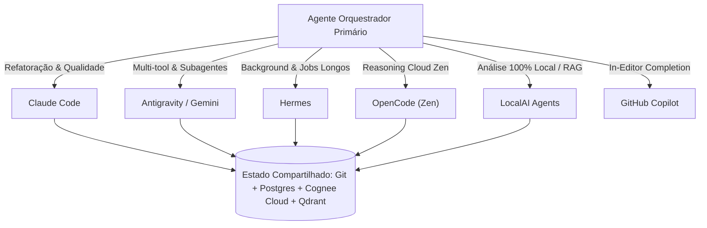

# Centro de Comando dos Agentes (Agent Command Center)

Este documento estabelece o **Centro de Comando e Governança Multi-Agente** para o ecossistema do projeto `tranfere_gov_api` e o workspace `/mnt/data/Projects_SSD`. Ele define os perfis de cada agente, matriz de especialidades, protocolos de delegação (local e remota) e salvaguardas para evitar conflitos de portas, memória, VRAM e banco de dados.

---

## 1. Mapa dos Agentes do Ecossistema

| Agente / Control Plane | Runtime & Interface | Ponto de Configuração | Escopo de Memória (Cognee) | Especialidades & Forças |
|---|---|---|---|---|
| **Google Antigravity (AGY) / Gemini** | CLI `antigravity` / AGY SDK / Gemini 3.7 | `.antigravity`, MCP Hub, Builtin Skills | Dataset Cloud / MCP Bridge | • Orquestração multi-tool MCP (`mcp-brasil`, `cognee`, DevTools) • Spawning de subagentes paralelos (`research`, `self`) • Raciocínio sequencial e diagnósticos de ponta a ponta |
| **Claude Code** | CLI `claude` (Anthropic) | `.claude/settings.json`, `.claude/skills/` | `claude_project_tranfere_gov_api` (:8011) | • Refatoração estrutural profunda e pipelines Python • Auditoria de código, conformidade com Ruff/Mypy • Execução rápida de testes e integração com hooks |
| **OpenAI Codex** | ChatGPT Desktop / Codex CLI | `.codex/`, `.cognee/config.json` | `codex_project_tranfere_gov_api` (:8011) | • Revisão estática de arquitetura e runbooks • Criação de suítes de testes unitários e harnesses • Documentação de padrões e validação de schema |
| **Hermes** | Daemon / CLI Autônomo | `~/.hermes/`, `.hermes/` | `hermes_global` (:8000) | • Tarefas autônomas em background de longa duração • Planejamento multi-etapas e monitoramento contínuo |
| **OpenCode** | OpenCode IDE / Serve | `.opencode/opencode.json` | Gateway Zen (`opencode.ai/zen/v1`) | • Modelos de raciocínio Zen (Nemotron-Free, GPT-5.6) • Extração e exploração sem consumo de VRAM local |
| **GitHub Copilot** | IDE Extension (VSCode/Cursor) | `.github/copilot-instructions.md` | Contexto de IDE local | • Autocompletion inline e documentação de docstrings • Geração de boilerplate e snippets rápidos |
| **LocalAI Agents (Em implantação)** | Server Local :8080 / `src/mcp/bridge.py` | `LocalAI/models/`, `src/localai_manager.py` | Postgres local (`cognee_db` / LocalAI KB) | • Execução 100% offline e privada (Qwen2.5-Coder-7B) • Custo zero de tokens, sem dependência de internet • Pipeline RAG e análise de dados governamentais |

---

## 2. Matriz de Delegação de Tarefas (Task Delegation Matrix)

Quando um agente estiver atuando como **Orquestrador Primário**, ele pode delegar tarefas específicas para outros agentes locais ou remotos conforme a matriz:

### Regras de Roteamento de Tarefas:

1. **Extração e Processamento Pesado de Dados Governamentais**:
   - **Delegar para**: Scripts Python diretos via `run.sh` ou agente local (`LocalAI` / `Claude Code`).
   - **Motivo**: Acesso direto ao PostgreSQL (`transferegov_db`) e Qdrant sem overhead de API.

2. **Orquestração de Múltiplos MCPs e Pesquisa Web**:
   - **Delegar para**: `Google Antigravity` / `Gemini`.
   - **Motivo**: Suporte nativo a lazy-loaded MCPs (`mcp-brasil`, `cognee`, `chrome-devtools`), subagentes assíncronos e busca integrada.

3. **Extração de Conhecimento Estruturado (Cognify) sem Custo**:
   - **Delegar para**: `OpenCode Zen` (com modelo `openai/nemotron-3.5-lightning-free`) ou `LocalAI`.
   - **Motivo**: Evita custos com modelos de raciocínio pesado em loops de extração.

4. **Tarefas Autônomas Assíncronas de Background**:
   - **Delegar para**: `Hermes` ou background tasks gerenciadas.
   - **Motivo**: Mantém o terminal principal livre para interação do desenvolvedor.

---

## 3. Protocolos de Comunicação e Estado Compartilhado

Para que todos os agentes colaborem harmoniosamente sem sobrescrever o trabalho uns dos outros:

### A. Memória Coletiva (Cognee Knowledge Fabric)
- **Meta-Conhecimento**: O que os agentes aprenderam sobre a arquitetura do sistema, configurações de portas e lições aprendidas fica no **Cognee** (Dataset `claude_project_tranfere_gov_api` ou `codex_project_tranfere_gov_api` e sincronizado via `push_to_cloud.sh`).
- **Consultas**: Agentes que precisam de contexto sobre decisões passadas usam `cognee-search` / `recall` com `search_type=GRAPH_COMPLETION` no tenant cloud.

### B. Sistema de Arquivos e Git
- **Branching / Workspaces**: Tarefas concorrentes complexas devem usar branches isoladas ou subagentes com workspace `branch` / `share`.
- **Handoff Files**: Quando um agente encerra uma fase para outro continuar, gera um artefato em `docs/plans/` ou `.agents/handoff.md` com status, testes executados e pendências.

### C. Gestão de Concorrência de Hardware (VRAM & Portas)
- **VRAM Exclusiva**: A GPU local (6GB) acomoda apenas **um** modelo de chat por vez (`Qwen2.5-Coder-7B-Instruct-GGUF`). Nenhum agente deve tentar instanciar servidores LLM paralelos sem passar pelo `LocalAIManager`.
- **Portas Fixas**: Consultar sempre `ports-and-services.json`. Não reatribuir portas em tempo de execução.

---

## 4. Como Configurar e Acionar Cada Agente

### Google Antigravity / Gemini CLI
- **Execução**: No terminal com `antigravity` ou via IDE AGY.
- **MCPs Habilitados**: `mcp-brasil`, `cognee`, `chrome-devtools-mcp`, `sequential-thinking`.
- **Subagentes**: `invoke_subagent` com roles especializados (`research`, `self`).

### Claude Code
- **Execução**: `claude` na raiz do repositório.
- **Configuração**: `.claude/settings.json` define `COGNEE_PLUGIN_DATASET=claude_project_tranfere_gov_api`.
- **Skills**: `.claude/skills/` disponíveis para testes, migrations e validação.

### OpenAI Codex
- **Execução**: Via interface Codex / ChatGPT Desktop.
- **Configuração**: `.cognee/config.json` define dataset `codex_project_tranfere_gov_api`.

### Hermes
- **Execução**: `hermes` CLI.
- **Configuração**: `~/.hermes/config.yaml` com bridge MCP para LocalAI e Cognee.

### LocalAI Agents (Roadmap Próxima Fase)
- **Ativação**: Chamadas via `src/mcp/bridge.py` ou endpoint compatível OpenAI na porta `:8080`.
- **Configuração YAML**: Modelos e perfis gerenciados em `/mnt/data/Projects_SSD/LocalAI/models/` e validados via `src/models_config.py`.
