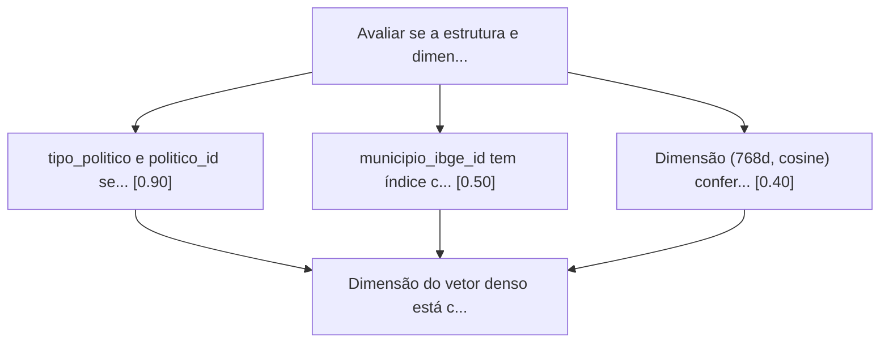
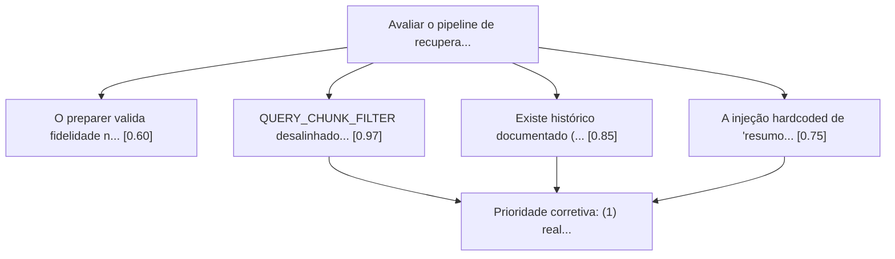
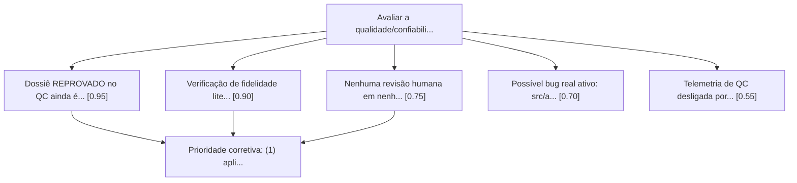
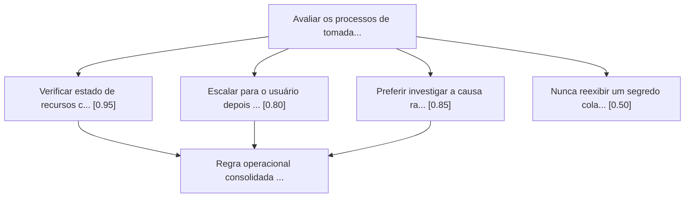

# Registro de revisões de decisão (graph-of-thought)

Log durável das revisões estruturadas feitas pelo [skill decision-review](../skills/decision-review/SKILL.md).
Cada entrada é de uma sessão real — decisões e incidentes que de fato aconteceram, não
cenários hipotéticos. Não editar entradas antigas; só adicionar novas no topo.

---

## 2026-08-17 — Revisão de qualidade de código (fechamento da sessão)

**Contexto:** skill `/code-review` (não graph-of-thought — esta entrada é de um processo
diferente, incluída aqui por ser o mesmo tipo de log durável de decisão/correção) rodado sobre
o diff completo desta sessão (9 arquivos modificados + 7 novos). 8 finder agents em paralelo (3
angles de corretude + reuse/simplification/efficiency + altitude/conventions), 1 verificador por
candidato sobrevivente.

**6 achados confirmados, 4 corrigidos nesta sessão, 2 adiados de propósito:**

| Achado | Categoria | Desfecho |
|---|---|---|
| `should_persist_memory()` roteava decisões curtas (<80 chars) pra `session` em vez de `cognee` — checagem de ruído rodava antes da checagem de marcador estável | correctness | **Corrigido** — ordem invertida, teste de regressão adicionado |
| `src/dash_app.py` continuava servindo dossiê reprovado no QC mesmo depois do fix na API — segunda via não corrigida do mesmo problema | correctness | **Corrigido** — reusa `get_dossie_deputado()` em vez de query própria; dropdown também filtrado |
| 404 da API dava a mesma mensagem para "nunca gerado" e "gerado mas reprovado" — engana quem for investigar | correctness | **Corrigido** — nova `dossie_existe_mas_reprovado()`, mensagens diferentes, 2 testes novos |
| Teste do `QUERY_CHUNK_FILTER` comparava contra cópia hardcoded, não protegia contra reordenar `QUERIES_TEMATICAS` no futuro | test-coverage | **Corrigido estruturalmente** — as duas listas paralelas viraram uma única lista de pares; teste trocado por checagem semântica (âncoras palavra-chave→tipo) |
| `should_persist_memory()` repete o mesmo padrão de dispatch (lower+markers+dict) 4x/7x no arquivo sem helper compartilhado | reuse | Adiado — baixo risco, refatoração maior |
| `check_payload_index_health()` usa `getattr(..., "")` com fallback silencioso pra `data_type` | simplification | Adiado — baixo risco, robustez marginal |

Suíte completa após as 4 correções: **428 testes passando**.

**Achado refutado com verificação empírica:** a hipótese de que `ensure_collection()` não
conseguiria "auto-curar" um índice com tipo trocado (precisaria de `delete_payload_index`
antes) foi testada direto contra um Qdrant real — `create_payload_index()` sobrescreve o índice
existente sem erro, mesmo com tipo diferente. Achado descartado, não é um problema real.

---

## 2026-08-17 — Estrutura e dimensões da coleção Qdrant (`deputados_perfis`)

**Contexto:** continuação da revisão do pipeline de retrieval, a pedido do usuário — checar se
a estrutura/dimensões da coleção Qdrant estão coerentes com o que o sistema precisa. Confirmado
ao vivo via API do Qdrant (`GET /collections/deputados_perfis`), não só leitura de código:
91.486 pontos, 183.770 vetores indexados.

**Achado positivo confirmado:** a dimensão do vetor denso (768d, cosine) confere exatamente com
o embedder `embeddinggemma-300m` — nenhuma incoerência aqui.

**Achado de estrutura:** o payload index list em `ensure_collection()`
(`src/enrichers/rag_qdrant_indexer.py`) só cobre `deputado_id`/`type`/`uf`/`municipio_ibge_id`/
`nivel_relevancia` — **não inclui `politico_id` nem `tipo_politico`**, que são os campos
canônicos usados em **toda** busca desde a Fase 3 (multi-cargo). Confirmado ao vivo (contagem
filtrada + amostra de payload) que os campos existem e estão populados corretamente — não é bug
de dado, só falta o índice. `ensure_collection()` ficou desatualizado em relação ao próprio
design multi-cargo do código que ela serve. Também achado: `municipio_ibge_id` tem índice
criado mas **0 dos 91.486 pontos** têm esse campo populado — índice morto.

**Ferramenta:** `graph-of-thought` (session_id `tranferegov-qdrant-estrutura-review-2026-08-17`).
`decision-matrix` reconfirmado bloqueado.

| Achado | Nota | Justificativa |
|---|---|---|
| `tipo_politico`/`politico_id` sem payload index apesar de uso em toda busca | **0.90** | Não quebra nada hoje (91k pontos, só deputados, ainda gerenciável), mas vira gargalo real assim que senador/prefeito/vereador forem backfillados — o volume multiplica. Fix de baixo esforço (2 chamadas a `create_payload_index`). |
| `municipio_ibge_id` com índice criado mas 0 pontos populados | 0.50 | Real, mas baixo impacto prático — custo de manutenção marginal. Vale investigar qual chunk type deveria populá-lo antes de decidir conectar ou remover. |
| Dimensão (768d, cosine) confere com embeddinggemma-300m | 0.40 | Confirmação positiva, não um problema — registrar que essa parte está correta. |
| `nivel_relevancia`/`uf` com baixa cobertura de pontos | 0.15 (auto-podado) | Comportamento esperado — campos específicos de poucos chunk types, não uma falha. |

**Síntese consolidada:** nenhuma ação na dimensão (está correta). Adicionar índices em
`politico_id` e `tipo_politico` antes do backfill multi-cargo crescer o volume. Investigar (não
necessariamente remover) o índice morto em `municipio_ibge_id`.

**Investigado e aplicado no mesmo dia:** o "índice morto" não era campo vazio — era **type
mismatch**. `_extract_municipio_financeiro()` grava `municipio_ibge_id` como INTEGER (ex:
`4109807`), mas o índice tinha sido criado como KEYWORD (string); Qdrant nunca casa os dois,
por isso 0 pontos indexados apesar de 3.318 pontos reais com o campo populado (confirmado via
scroll direto na coleção). Corrigido:
- `municipio_ibge_id` recriado como INTEGER (era KEYWORD) — agora 3.318/3.318 pontos indexados.
- `politico_id` (INTEGER) e `tipo_politico` (KEYWORD) criados — agora 91.486/91.486 cada.
- Aplicado direto na coleção viva (metadado só, nenhum vetor/dado tocado) e no código
  (`ensure_collection()` em `src/enrichers/rag_qdrant_indexer.py`), extraído para uma constante
  única `PAYLOAD_INDEXES` para não haver duas fontes de verdade.
- Nova função `check_payload_index_health()` compara a coleção real contra `PAYLOAD_INDEXES` e
  reporta índice ausente ou com tipo errado — integrada em `src/qdrant_status.py` (rodar
  `./run.sh qdrant-status` já mostra isso de agora em diante, sem precisar de outra investigação
  manual). 3 testes novos em `tests/test_rag_qdrant_indexer_health.py`, incluindo regressão
  exata do bug (índice KEYWORD com dado INTEGER). Suíte completa: 426 testes passando.

---

## 2026-08-17 — Pipeline de recuperação (Qdrant) e preparer (`rag_persona.py`/`preparer.py`)

**Contexto:** aprofundamento do item anterior (revisão do `src/analysts/`), a pedido do
usuário: focar especificamente no estágio mais upstream — a recuperação de chunks no Qdrant
(`search_context_multiquery`) e a síntese de briefing em 6 estágios (`PromptPreparer`) que
alimentam os 7 analistas. Só processo/código, sem conteúdo real de dossiê.

**Achado principal — verificado mecanicamente com script, não leitura manual:**
`QUERY_CHUNK_FILTER` em `rag_persona.py` desalinha **7 das 15 queries temáticas (índices 6 a
12)** — cada uma dessas filtra a busca vetorial por um tipo de chunk semanticamente diferente
do que a própria query pergunta. Exemplos reais:

| Índice | Query pergunta sobre... | Filtro aplicado (errado) |
|---|---|---|
| 6 | finanças do governo **estadual** (SICONFI) | `DEMOGRAFIA_MUNICIPIO` |
| 7 | dados **demográficos** IBGE | `INDICADORES_SOCIAIS`, `INDICADORES_MUNICIPAL` |
| 8 | indicadores de **saúde/educação** | `FNDE_REPASSES` |
| 9 | repasses **FNDE** | `CONEXAO_POLITICA`, `PREFEITO`, `VEREADORES_RESUMO`, `SENADOR` |
| 10 | **conexão política** local | `RISCO_JUDICIAL`, `DIARIO_OFICIAL`, `PARLAMENTAR_ALERTAS` |
| 11 | **risco judicial** e compliance | `COMPRAS_MUNICIPIO`, `BENEFICIARIO` |
| 12 | **compras públicas** e licitações | `DISCURSO_PLENARIO` |

O índice 13 "acerta" por coincidência (ambos `DISCURSO_PLENARIO`), mascarando o padrão.

**Ferramenta:** `graph-of-thought` (session_id `tranferegov-preparer-qdrant-review-2026-08-17`).
`decision-matrix` reconfirmado bloqueado.

| Achado | Nota | Justificativa |
|---|---|---|
| `QUERY_CHUNK_FILTER` desalinhado em 7 de 15 queries | **0.97** | Explica um mecanismo causal plausível para exatamente as categorias já identificadas como mais fracas na revisão anterior (risco_judicial, conexão política) — pode ser "chunk errado retornado", não só "verificação insuficiente". Fix de baixíssimo esforço. |
| Sem teste de invariante para cobertura de `chunk_types` nas queries | 0.85 | Já existe histórico de regressão idêntica (bug de 2026-07-31, 7 tipos nunca buscados) sem teste protegendo contra reincidência — o achado acima é prova de que a garantia informal já quebrou de novo. |
| Injeção de "resumos por área" (`_buscar_resumos_por_area`) é hardcoded só para emenda/emenda_discricionária | 0.75 | Resolve um sintoma real e documentado (92% de invenção sem ela), mas é patch pontual — a mesma perda pode estar ocorrendo silenciosamente noutras categorias sem golden-set case para detectar. |
| Preparer valida fidelidade só de R$; herda erro de retrieval mesmo quando 100% fiel aos chunks recebidos | 0.60 | Reafirma gap já registrado na revisão anterior sob ângulo novo — contexto, não achado independente. |

**Síntese consolidada:** (1) realinhar `QUERY_CHUNK_FILTER` com `QUERIES_TEMATICAS` — maior
impacto potencial de toda a revisão, menor esforço; (2) adicionar teste de invariante contra
esse tipo de regressão (já aconteceu duas vezes); (3) considerar generalizar a injeção de
resumos canônicos para outras categorias, só depois de confirmar com dados reais se sofrem a
mesma perda.

**Aplicado no mesmo dia:** itens 1 e 2 corrigidos e testados —
`QUERY_CHUNK_FILTER` realinhado (índices 6-14, incluindo `ESTADO_FINANCEIRO` que faltava por
completo) em `src/enrichers/rag_persona.py`; três testes novos em
`tests/test_rag_persona_query_filter.py` (cobertura de todos os 23 tipos indexados, cobertura
de todos os índices de `QUERIES_TEMATICAS`, e alinhamento exato travado — a classe de bug
encontrada hoje não pode mais recorrer silenciosamente). Suíte completa: 423 testes passando
(instalei `qdrant-client`, `cachetools`, `plotly`, `psycopg2-binary` — dependências já
declaradas em `requirements.txt` mas ausentes deste ambiente local; não achei nenhuma
regressão além das já conhecidas). Item 3 (generalizar injeção de resumos canônicos) continua
pendente — precisa de dados reais antes de decidir.

---

## 2026-08-17 — Processo de análise do módulo `src/analysts/` (dossiês de políticos)

**Contexto:** revisão de qualidade/confiabilidade do pipeline real que gera os dossiês
comportamentais de políticos — não uma revisão de conteúdo de nenhum dossiê específico, só do
processo/código. Processo mapeado por leitura direta do código (não LangGraph, como uma
memória recuperada sugeria — é um pipeline próprio em `src/analysts/` com `ThreadPoolExecutor`,
totalmente independente do módulo Redator, que é template+SQL e não consome saída dos
analistas). Detalhe completo do processo real fica só neste registro de decisão, não em
nenhum dataset do Cognee — mantém o `scope_boundary` já documentado em
`cognee-architecture.json` (Cognee nunca processa dado de domínio político).

**Ferramenta:** `graph-of-thought` (session_id `tranferegov-analistas-process-review-2026-08-17`).
`decision-matrix` reconfirmado bloqueado antes de começar.

| Gap encontrado | Nota | Justificativa |
|---|---|---|
| Dossiê **REPROVADO** no QC ainda é servido ao usuário final — `db_service.py::get_dossie_politico()` não filtra por `qualidade_ok`, só existe um aviso inline em markdown | **0.95** | Desfaz a garantia do próprio QC que o sistema já implementa; correção de baixo esforço (o campo já existe). |
| Verificação de fidelidade literal cobre só valores R$ (tolerância 2%) — alegações de risco judicial/rede política só checam se existe chunk do *tipo* certo, não se o conteúdo bate | 0.90 | A cobertura está invertida em relação ao risco: as alegações mais sensíveis têm a checagem mais fraca. |
| Nenhuma revisão humana em nenhum estágio — geração, QC e publicação são 100% automatizados | 0.75 | Causa raiz comum por trás de vários outros gaps; correção estrutural maior, custo operacional mais alto. |
| Telemetria de QC desligada por padrão (`RAG_PERSIST_QC=false`) — sem trilha de auditoria persistida | 0.55 | Importante pra diagnóstico de longo prazo, mas não afeta o dossiê publicado agora. |
| Bug real confirmado em `src/analysts/cruzamento.py:61` (`briefing.texto`, atributo inexistente — a dataclass `Briefing` define `.text`) no 2º analista de maior peso (20%) | 0.70 | Verificado no código antes de pontuar. Prioridade condicional a confirmar se o path (`briefing.is_useful=True`) é exercitado em produção. |

**Síntese consolidada (prioridade corretiva):** (1) aplicar o filtro `qualidade_ok` em
`get_dossie_politico()` — menor esforço, maior redução de risco imediato; (2) estender a
verificação de fidelidade literal além de R$, priorizando risco_judicial e
rede_política/apadrinhamento — categorias de maior dano reputacional com a checagem hoje mais
fraca; (3) revisão humana é a correção estrutural de fundo, mas deve vir depois dos dois fixes
pontuais acima, não como bloqueio para eles.

**Aplicado no mesmo dia:** os dois itens de menor esforço foram corrigidos e testados —
`src/api/services/db_service.py::get_dossie_politico()` agora filtra `qualidade_ok IS NOT
FALSE`; `src/analysts/cruzamento.py:61` corrigido de `briefing.texto` para `briefing.text`,
com teste de regressão em `tests/test_analysts_base.py::test_cruzamento_build_prompt_com_briefing_util`
(passou antes de existir o fix seria um `AttributeError`). Itens 2 e 3 da síntese (fidelidade
não-monetária, revisão humana) continuam pendentes.

---

## 2026-08-17 — Saga de bootstrap do Cognee/LocalAI (sessão de confiabilidade do Cognee)

**Contexto:** revisão da própria sessão de trabalho — plano de confiabilidade do Cognee
(customPrompt anti-fabricação, patches de dataset automático) seguido de uma longa saga de
bootstrap do dataset `claude_project_localai` (9 tentativas reais, 3 provedores, um incidente
real de VRAM cheia por falta de checagem prévia).

**Ferramenta:** `graph-of-thought` (session_id `tranferegov-decision-process-eval-2026-08-17`).
`decision-matrix` confirmado bloqueado (`ENGINE_NOT_IN_PLAN`, plano `trial`) antes de começar.

| Lição | Nota | Justificativa |
|---|---|---|
| Verificar estado de recurso compartilhado (VRAM, saldo de API) **antes** de agir, não só tratar erro depois | **0.95** | Erro mais caro da sessão: carreguei `qwen3.5-4b-dflash` sem rodar `nvidia-smi` primeiro, apesar da informação já estar documentada no workspace. Causou indisponibilidade real da ponte `:8011`. |
| Investigar a causa raiz completa (ler o erro inteiro, config, docs existentes) antes de trocar de abordagem | 0.85 | Resolveu de verdade dois problemas nesta sessão (achar `ctx_other` do dflash na própria mensagem de erro; achar os modos do instructor pro Cloudflare) — mais eficiente que tentativa-e-erro cega. |
| Escalar pro usuário assim que a próxima tentativa representar uma causa-raiz **genuinamente nova**, não depois de N tentativas fixas | 0.80 | Inconsistente: a primeira rodada (Zen/local/Cloudflare) escalou cedo e bem; a segunda (3 tentativas do mesmo modelo variando só o timeout) devia ter sido reportada em bloco. |
| Nunca reexibir segredo colado pelo usuário no chat | 0.50 | Comportamento correto (token do Cloudflare nunca foi ecoado de volta), mas amostra única nesta sessão — pouca evidência pra virar "padrão comprovado" localmente, ainda que a regra já valha por instrução operacional geral. |

**Síntese consolidada (regra operacional):** antes de consumir um recurso finito
compartilhado, checar o estado atual primeiro — não só tratar o erro depois. Ao investigar uma
falha técnica, ler a causa raiz completa antes de trocar de abordagem. Escalar por *tipo de
causa nova*, não por contagem de tentativas — múltiplas tentativas variando só um parâmetro no
mesmo problema devem ser reportadas como um bloco, não silenciosamente uma por uma.

