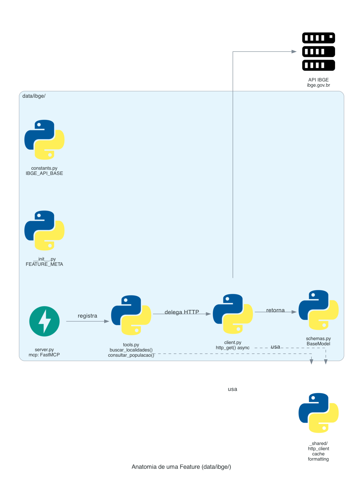
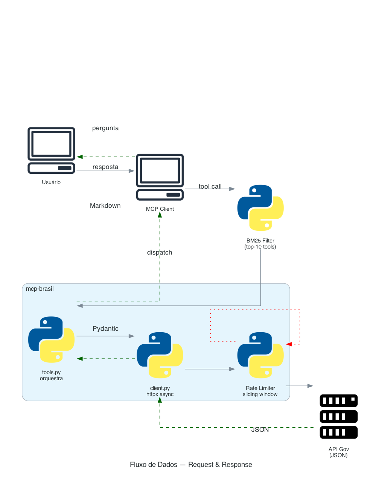

# Arquitetura

## Visao geral

```
src/mcp_brasil/
├── server.py              # Auto-registry — nunca editado manualmente
├── settings.py            # Configuracao via env vars
├── exceptions.py          # Excecoes customizadas
├── _shared/               # Utilitarios compartilhados (10 modulos)
├── data/                  # 26 features de consulta a APIs
│   ├── ibge/
│   ├── bacen/
│   ├── camara/
│   ├── senado/
│   ├── transparencia/
│   ├── tcu/
│   ├── tce_sp/  tce_rj/  tce_rs/  tce_sc/  tce_pe/
│   ├── tce_ce/  tce_rn/  tce_pi/  tce_to/
│   ├── datajud/
│   ├── jurisprudencia/
│   ├── tse/
│   ├── inpe/
│   ├── ana/
│   ├── saude/
│   ├── compras/           # Umbrella: pncp/ + dadosabertos/
│   ├── brasilapi/
│   ├── dados_abertos/
│   ├── diario_oficial/
│   └── transferegov/
└── agentes/               # Agentes inteligentes
    └── redator/
```

## Camadas

### 1. Auto-Registry (`server.py` raiz)

O server raiz **nunca e editado manualmente**. O `FeatureRegistry` descobre features automaticamente:

```python
mcp = FastMCP("mcp-brasil")
registry = FeatureRegistry()
registry.discover("mcp_brasil.data")
registry.discover("mcp_brasil.agentes")
registry.mount_all(mcp)
```

O fluxo de discovery para cada pacote:

1. Escaneia sub-pacotes (exceto `_`-prefixados) via `pkgutil.iter_modules()`
2. Importa `__init__.py` — deve exportar `FEATURE_META: FeatureMeta`
3. Se `requires_auth=True` e a env var nao esta definida, pula silenciosamente
4. Importa `server.py` — deve exportar `mcp: FastMCP`
5. Chama `root_server.mount(feature.mcp, namespace=name)` — prefixa tools como `{name}_*`

Para adicionar uma feature: crie o diretorio seguindo a convencao. Zero mudancas em arquivos existentes.

### 2. Anatomia de uma Feature



Cada feature e uma pasta auto-contida com estrutura fixa:

```
data/{feature}/
├── __init__.py     # FEATURE_META (obrigatorio para discovery)
├── server.py       # mcp: FastMCP (obrigatorio)
├── tools.py        # Funcoes das tools
├── client.py       # HTTP async para a API
├── schemas.py      # Pydantic models
└── constants.py    # URLs, enums, codigos
```

**Fluxo de dependencia** (direcao unica, nunca ao contrario):

```
server.py → tools.py → client.py → schemas.py
  registra    orquestra   faz HTTP     dados puros
```

Regras:
- `tools.py` **nunca faz HTTP** — delega para `client.py`
- `client.py` **nunca formata para LLM** — retorna Pydantic models
- `schemas.py` tem **zero logica** — apenas BaseModel
- `server.py` da feature **apenas registra** — zero logica de negocio
- `constants.py` tem **zero imports** de outros modulos do projeto

### 3. Utilitarios compartilhados (`_shared/`)

| Modulo | Funcao |
|--------|--------|
| `feature.py` | `FeatureRegistry` + `FeatureMeta` — engine de auto-discovery |
| `http_client.py` | httpx async com retry/backoff em 429/5xx/timeout |
| `cache.py` | TTL cache in-memory + decorator `@ttl_cache` |
| `formatting.py` | Markdown tables, `format_brl()`, `format_number_br()` |
| `validators.py` | Validacao de CPF, CNPJ, CEP |
| `rate_limiter.py` | Sliding-window async rate limiter |
| `batch.py` | Execucao paralela de ate 10 tool calls |
| `discovery.py` | Catalogo de tools + recomendacao via LLM |
| `planner.py` | Planos de execucao estruturados via LLM |
| `lifespan.py` | Lifespan compartilhado para httpx.AsyncClient |

### 4. Meta-Tools (server raiz)

Alem das 201 tools das features, o server raiz expoe 4 meta-tools:

| Tool | O que faz |
|------|-----------|
| `listar_features` | Lista todas as features ativas com status de autenticacao |
| `recomendar_tools` | Recomenda 3-5 tools relevantes a partir de uma pergunta em linguagem natural |
| `planejar_consulta` | Cria plano de execucao estruturado combinando multiplas APIs |
| `executar_lote` | Executa ate 10 tool calls em paralelo numa unica chamada |

Veja [Smart Tools](../reference/smart-tools.md) para detalhes.

### 5. Tool Search Transform

O server filtra as 205 tools para mostrar apenas as relevantes ao contexto do LLM:

| Modo (`MCP_BRASIL_TOOL_SEARCH`) | Comportamento |
|---------------------------------|---------------|
| `bm25` (default) | BM25 ranking — top-10 tools mais relevantes; meta-tools sempre visiveis |
| `code_mode` | Experimental — discovery via `get_tags`, `search`, `GetSchemas` |
| `none` | Todas as 205 tools visiveis (sem filtragem) |

## Fluxo de dados



```
Pergunta do usuario
  → Cliente MCP (Claude, GPT, etc.)
    → Tool call (ex: bacen_consultar_serie)
      → tools.py (orquestra)
        → client.py (HTTP async)
          → API do governo
          ← JSON response
        ← Pydantic model
      ← Resposta formatada (markdown/texto)
    ← Resposta ao usuario
```

Features com rate limiting e retry:

```
client.py
  → http_client.http_get(url, params)
    → rate_limiter (sliding window)
    → httpx.AsyncClient.get()
    ← Retry em 429/5xx/timeout (backoff exponencial)
    ← TTL cache (quando habilitado)
  ← Dados tipados
```

## Decisoes de design

1. **FastMCP v3** — elimina boilerplate de auth/error/response do MCP SDK
2. **Package by Feature** — cada API e auto-contida; sem camadas horizontais
3. **Auto-registry** — `FeatureRegistry` descobre features sem imports manuais
4. **Async everywhere** — `async def` em todas as tools e clients
5. **Pydantic v2** — validacao e serializacao de dados da API
6. **BM25 filtering** — 205 tools e demais para um LLM; filtra para top-10 relevantes
7. **mount() com namespace** — prefixa automaticamente tools/resources/prompts por feature
